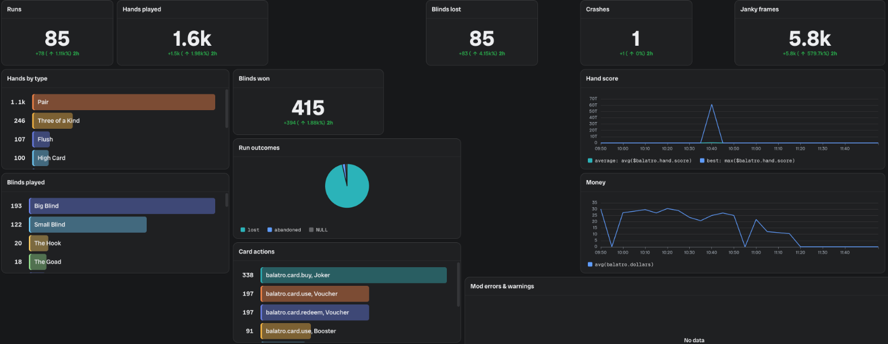
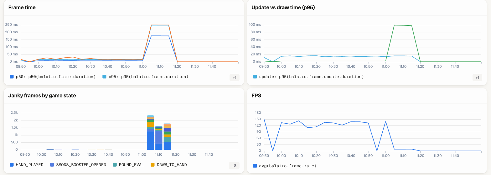

# balatro-otel

[](https://github.com/svrnm/balatro-otel/actions/workflows/ci.yml)
[](LICENSE)

OpenTelemetry for [Balatro](https://www.playbalatro.com/): a [Steamodded](https://github.com/Steamodded/smods)
mod that turns a game into traces, logs and metrics, plus the tooling to test it by letting a bot
play the game headless in containers.

> Unofficial fan project. Not affiliated with or endorsed by LocalThunk or Playstack. Balatro is a
> trademark of LocalThunk. This repository contains no game code or assets; the tooling works with
> your own copy of the game.

## What you get

- **Traces**: `balatro.run` → `balatro.blind` → `balatro.hand` → `balatro.hand.scoring` →
  `balatro.card.evaluate` (each card and joker that scored), plus `balatro.shop` → `balatro.booster_pack`.
  Spans carry the seed, deck, stake, scores, money, and per-blind frame timing, memory and render stats.
- **Events** (log records with an event name, linked to the open span): scoring effects, discards,
  card buys/sells/uses, rerolls, skipped blinds, `app.jank` for frame hitches, `app.crash` with the
  Lua stack trace, `session.start`.
- **Metrics**: frame time and jank, update vs draw time, FPS, Lua memory, event queue length, render
  stats, hands, score, money, ante, crashes.

Every name is defined in a [Weaver](https://github.com/open-telemetry/weaver) registry
(`telemetry/registry`) on top of OpenTelemetry semantic conventions v1.44.0.

## Quick start

1. Install [Lovely](https://github.com/ethangreen-dev/lovely-injector) and
   [Steamodded](https://github.com/Steamodded/smods) following their guides for your OS.
2. Download `otel-trace.zip` from the [releases](https://github.com/svrnm/balatro-otel/releases) and
   unzip it into Balatro's `Mods` folder (or copy `mod/otel-trace` there).
3. Start a collector with Jaeger and Prometheus (Docker):
   ```sh
   docker compose -f telemetry/stack/compose.yaml up -d
   ```
4. Play. Then look at:
   - traces in Jaeger: http://localhost:16686 (service `balatro`)
   - metrics in Prometheus: http://localhost:9090, e.g.
     `histogram_quantile(0.99, sum by (le) (rate(balatro_frame_duration_seconds_bucket[5m])))` or
     `sum by (balatro_hand_type) (balatro_hands_total)`
   - logs and events: `telemetry/stack/data/logs.jsonl` (one OTLP/JSON request per line), e.g.
     `jq -c '.resourceLogs[].scopeLogs[].logRecords[] | select(.eventName == "app.crash")' telemetry/stack/data/logs.jsonl`

The mod sends to `http://127.0.0.1:4318` by default; change it in the game under **Mods → OTel Trace →
Config** or with `OTEL_EXPORTER_OTLP_ENDPOINT`. It sends from a background
thread, every 10 s and at the end of each blind and run. What it sends, and what it does not, is in
the [mod's README](mod/otel-trace/README.md#privacy).

## Repository

```
mod/otel-trace/          the mod: main.lua (game hooks), otel.lua (OTLP exporter), metadata, icon
telemetry/stack/         Collector + Jaeger + Prometheus (+ log file) for local use
telemetry/registry/      Weaver registry: attributes, spans, events, metrics
telemetry/               test tooling: live-check, autoplay, container runner, chaos, scenarios
integrations/bronto/     optional: also send to Bronto, with a dashboard and monitors
tests/otel_test.lua      offline check of the exporter
```

## Development and testing

### Offline and registry checks

```sh
lua tests/otel_test.lua /tmp/otlp   # asserts the OTLP shape, writes sample traces/logs/metrics.json
                                    # (SMODS_DIR: a Steamodded checkout, for its json library)
docker run --rm -v "$PWD/telemetry:/telemetry" otel/weaver:v0.28.0 registry check --v2 -r /telemetry/registry
```

Weaver live-check validates what the mod actually emits: `telemetry/live-check.sh start` runs Weaver
and a collector on `localhost:4319` that forwards to Weaver and to the stack; send telemetry there
(or launch the game with `OTEL_EXPORTER_OTLP_ENDPOINT=http://127.0.0.1:4319`), then
`telemetry/live-check.sh stop` prints the summary.

### Automated play

[BalatroBot](https://github.com/coder/balatrobot) exposes the game over JSON-RPC, and
`telemetry/autoplay.py` plays seeded runs through it. On macOS, `telemetry/install-balatrobot.sh`
installs Lovely 0.10.0, Steamodded 1.0.0~BETA-1814a and BalatroBot 1.5.2, and `telemetry/e2e.sh`
plays one run against live-check.

### Containers (headless, parallel, long-running)

`telemetry/container/` runs the game on Linux in Docker (LÖVE 11.5, Lovely built from source, Xvfb,
Steamodded, BalatroBot). The game is not in the image: `Balatro.love` from your Steam install and your
save folder are mounted read-only and copied inside the container.

```sh
docker build -t balatro-otel-runner telemetry/container
telemetry/container/run.sh                                     # one RED/WHITE run
telemetry/container/run.sh RED:WHITE:3 BLUE:RED:3              # parallel containers
telemetry/container/run.sh RED:WHITE:1::mouth                  # a known-issue scenario
telemetry/soak.sh 60                                           # an hour of mixed runs, faults and scenarios
```

After each run, `telemetry/check_traces.py` checks what reached Jaeger and the log file: every run has
an outcome and blinds, each blind's score equals the sum of its hands, each hand added to the blind
what it scored, no failed spans, no hook failures, and Lua memory does not grow from run to run.

- `telemetry/chaos/` injects faults (jank, slow jokers, memory leak, mod errors, crashes, heavy
  rendering) and reports where each one surfaced, next to a clean baseline.
- `telemetry/scenarios.py` reproduces known Balatro and Steamodded issues (a Perkeo crash, a
  Spectral-pack softlock, retrigger-heavy scoring, boss blinds that debuff hands). Several scoring
  mismatches it finds come from
  Steamodded 1.0.0~BETA-1814a and are fixed in Steamodded 26.829.0 and later; the containers stay on
  that version until BalatroBot supports newer Steamodded
  ([coder/balatrobot#244](https://github.com/coder/balatrobot/issues/244)).
- The image patches BalatroBot's cut-off replies under load
  ([coder/balatrobot#243](https://github.com/coder/balatrobot/issues/243)).

## Integrations

### Bronto

I work at [Bronto](https://www.bronto.io/), so this is the backend I use on top of the local stack.
`integrations/bronto/` adds a collector exporter that sends everything to Bronto as well:

```sh
BRONTO_API_KEY=... BRONTO_REGION=eu docker compose \
  -f telemetry/stack/compose.yaml -f integrations/bronto/compose.yaml up -d
```

It also has a dashboard (`dashboard.yaml`, for `bronto dashboards apply`) and monitors for crashes,
mod errors, jank spikes, slow scoring, Lua memory and score mismatches (`create_monitors.sh`).




On macOS I usually skip the Docker stack and let [compy](https://github.com/bronto-community/compy),
a local OpenTelemetry Collector manager, receive the game's telemetry and forward it to Bronto: start
the game with `OTEL_EXPORTER_OTLP_ENDPOINT=http://127.0.0.1:14318` (compy's default OTLP/HTTP port).

Any other OTLP backend works the same way: add an exporter to `telemetry/stack/otelcol.yaml`.

## Conventions

- Custom names live under `balatro.*`; durations are in seconds; counts use `{unit}` annotations.
- Events are log records with an event name, not span events (OTEP 4430).
- Upstream conventions used: `service.*`, `telemetry.sdk.*`, `os.type`, `session.id` + `session.start`,
  `app.jank`, `app.crash` + `exception.*`, `error.type`.

## License

[Apache-2.0](LICENSE). Balatro is a trademark of LocalThunk; game footage and assets are not part of
this repository.
